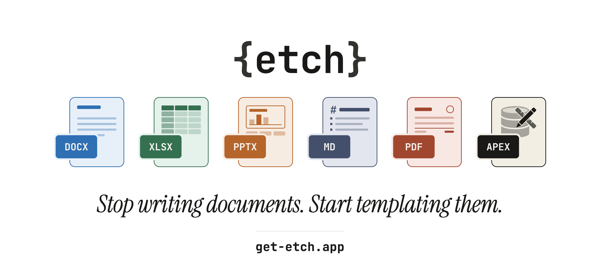

<p align="center">
  <a href="https://get-etch.app">
    <picture>
      <source media="(prefers-color-scheme: dark)" srcset=".github/etch-banner-dark.png">
      
    </picture>
  </a>
</p>

# ETCH client examples

[ETCH](https://get-etch.app) fills Word, Excel, PowerPoint and Markdown templates with your data and
returns finished documents, in the template's own format or as PDF.

These examples are small, runnable programs that use the ETCH client libraries. Each one exists in
Python and in JavaScript, in a folder with the same name, and uses the same template and data, so
you can compare the two side by side.

To run them, you need an ETCH account. The free plan needs no card.
[Create a free account](https://get-etch.app/signup).

## Before you start

From your ETCH dashboard, copy two values:

- Your package token, from the Integrations page. The client libraries are published on the ETCH
  package registry, `packages.get-etch.app`, and your package manager uses the token to download
  them.
- An API key, from the API keys page. The examples read it from the `ETCH_API_KEY` environment
  variable.

The examples call `https://api.get-etch.app`. To use another ETCH server, set `ETCH_BASE_URL`.

## Languages

Start with [Python](python/) or [JavaScript](javascript/). Each folder has a README that lists its
examples and an `INSTALL.md` that sets up the client on macOS, Linux and Windows.

## Examples

Both languages have the same numbered folders, one per example, each with its own README.

| Folder | What it shows |
|---|---|
| `01-quick-start` | Load data from a JSON file and render a Word template |
| `02-data-built-in-code` | Build the data in code: line items from a list, totals and dates calculated at runtime |
| `03-data-from-url` | Fetch the data from a URL, optionally with a bearer token |
| `04-images` | Add a logo to the data and render a template with an image tag |
| `05-attachments` | Send product pictures as attachments instead of base64 in the JSON |
| `06-variables` | Use nested paths, default values and built-in variables in a welcome letter |
| `07-formatters` | Format dates, money, percentages and text in a bank statement |
| `08-conditionals` | Write three renewal letters from one template with if, else, unless, switch and comparisons |
| `09-loops` | Loop over lists and objects in an order summary, with nested loops, loop variables and repeat |
| `10-helpers` | Work out a sales report's totals, averages and rankings in the template |
| `11-reusable-blocks` | Define a quote's signature block once and use it for both parties |
| `12-qr-codes-and-barcodes` | Put a tracking barcode, a QR code and product barcodes on a shipping label |
| `13-excel` | Build an Excel workbook with a row loop, totals that follow it, and one sheet per region |
| `14-powerpoint` | Build a PowerPoint deck with one slide per project, speaker notes and a summary table |
| `15-one-page-per-record` | Make a certificate for each attendee, one per page, in a single Word document |
| `16-output-formats` | Render to Word and PDF, password-protect a document, and convert a document to PDF |
| `17-batch` | Render an invoice per record in one request, and save them as files and as a zip |
| `18-stored-templates` | Store a template on ETCH, render it by name, then replace, download and delete it |
| `19-error-handling` | Handle a wrong API key, a missing template and missing data |
| `20-configuration` | Set the server address, API key, timeout and retries, and watch a timeout fire |
| `21-inline-templates` | Write a Markdown template in the program: an order confirmation for an email |
| `22-missing-values` | Choose what happens when the data lacks a value: fail, leave it out, or keep the tag |
| `23-concurrent-requests` | Send several separate renders in parallel, with a limit, and compare that with a batch |
| `24-server-information` | Check the server's health and version, and what the licence allows, before starting work |
| `25-template-from-url` | Render a template downloaded from a URL, without sending the API key to the template's host |
| `26-folders` | Keep stored templates in folders and render one by its path |
| `27-typed-data` | Build the data from the language's own types: dates, exact decimals, a renamed field and a null |
| `28-rename-and-move` | Rename a stored template, move it to another folder, and render it at its new path |

Each example writes its document to an `output` folder inside its own folder.

## Integrations

The `integrations` folder holds larger examples that put a client library inside another tool.
Each has its own README.

| Folder | What it shows |
|---|---|
| [`integrations/sqlcl`](integrations/sqlcl/) | An `etch` command for Oracle SQLcl, built on the JavaScript client, that renders a template from a SQL query at the SQL prompt |

## Repository layout

```text
python/         Python examples
javascript/     JavaScript examples
integrations/   examples that run inside other tools
templates/      Word, Excel, PowerPoint and Markdown templates
data/           sample JSON data
images/         images the examples use
```

The `docs` folder in each language holds the code shown on that language's page of the ETCH
documentation. To learn more about the template syntax and the client libraries, see the
[ETCH documentation](https://get-etch.app/docs).

## Licence and contributing

The examples are released under the MIT License; see [LICENSE](LICENSE). To report a problem or
suggest a change, see [CONTRIBUTING.md](CONTRIBUTING.md). To report a security vulnerability, see
[SECURITY.md](SECURITY.md).
